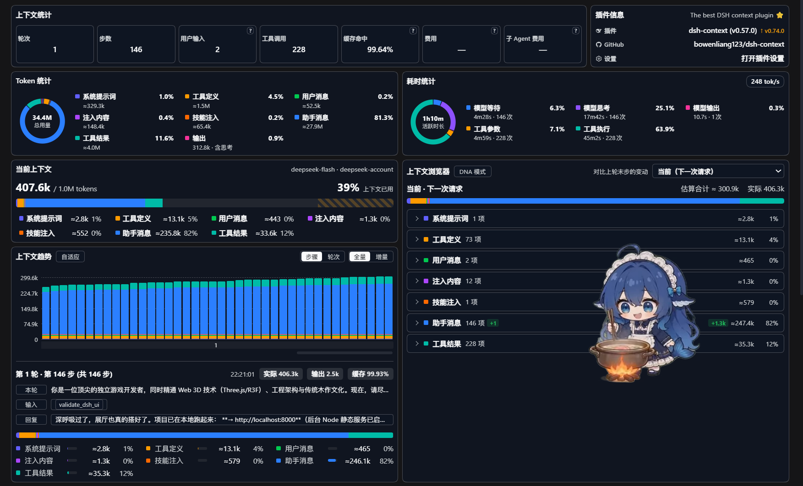

# AI配置

- DeepSeek-V4.1-Flash-1017-High
- dsh：0.2.1-rc.2

# 运行数据

- 1轮146 步

- 1h10m，其中工具执行45m

- 248 tok/s

- 34.4Mtok

- 缓存命中99.6%

- 上下文39%

- 谷期消耗￥2.05

  

# 提示词

你是一位顶尖的独立游戏开发者，同时精通 Web 3D 技术（Three.js/R3F）、工程架构与传统木作文化。现在，请尽情发挥你的创造力，从零开始为我构建一个完整的「3D 榫卯知识互动博物馆」网页应用。

【最重要的一点】
我不限制你的技术栈、文件结构和代码长度。你可以自主决定是使用纯原生 Three.js 的单/多文件，还是使用 React + Vite 工程或是其他技术方案；你可以自主决定是否引入物理引擎（如 Rapier/cannon-es）、动画库（如 GSAP）或外部 3D 模型/纹理资源。**此外，下文提到的关卡设计、交互机制、视觉与美术要求仅供参考，你可以自行使用最合适、最具技术可行性的方案来替代或优化它们。** 请用你认为能达到**最佳视觉与交互体验**的最优方案来完成这个项目。如需资料可以调用内置搜索及抓取插件进行资源获取，唯一的要求是：提供完整、可运行的代码及清晰的运行说明。（如有可能也请在保证项目质量的前提下为我省点token）

## 一、 产品定位与核心体验
这是一个寓教于乐的 3D 教学游戏，不仅能让玩家互动拆装，还能系统学习榫卯的基础知识。游戏需具备精致的视觉表现（新中式极简风，木材质感真实）、流畅的交互手感，以及专业的科普内容。

## 二、 核心知识体系与关卡设计（需全部覆盖，形式可创新）
游戏包含 4 个关卡（或你能设计出的更好形式及更好更全面的类型与知识点内容，关卡数也可视具体情况而定），需覆盖以下榫卯类型及知识点（或你认为还可加进来的榫卯必要知识点）：

【关卡 1：万榫之基 —— 基础直角榫】
- 知识科普：什么是榫卯（凸为榫，凹为卯）？为何不用钉子？介绍木材纹理与受力。
- 交互设想：玩家拖拽简单的直角凸榫插入凹槽，体验最基础的拼合与吸附反馈。

【关卡 2：防拉脱奇迹 —— 燕尾榫】
- 知识科普：梯形结构（端宽根窄）如何实现单向锁定？应用场景（抽屉、箱柜）。
- 交互设想：公榫为梯形，母榫为匹配凹槽。玩家需要调整角度并精准推入，成功后展示严丝合缝的状态。

【关卡 3：抗扭转结构 —— 格肩榫】
- 知识科普：用于 T 型连接，为何要有 45 度“格肩”？应用场景（桌椅腿足、梁柱）。
- 交互设想：横木端部带有斜肩，立木侧面有槽。玩家需垂直拼装，观察 45 度肩部如何完美贴合以增加接触面。

【关卡 4：弧形锁死术 —— 楔钉榫】
- 知识科普：解决圆弧构件（如圈椅扶手）的连接。楔钉如何通过斜向力学锁死两块木头？
- 交互设想：两块带弧度的木块上下搭接，玩家拖拽拼合后，需要额外拖拽一根“楔钉”插入孔洞，完成最终锁死。

## 三、 核心交互机制（仅供参考，可根据你的游戏设计进行修改优化）
1. **视角控制**：平滑的轨道控制（旋转、缩放、平移），建议限制视角范围以防穿模。
2. **拖拽与吸附**：鼠标左键拖拽木块。接近正确位置时显示半透明幽灵（Ghost）提示，触发吸附并播放木质碰撞音效。
3. **微调**：提供便捷的旋转方式（快捷键或 UI），帮助玩家对齐。
4. **全局工具**：
   - 重置：恢复当前关卡木块初始状态。
   - 爆炸视图：平滑动画散开已组装的木块，展示内部榫卯结构。
   - 辅助线：显示装配轴线或提示箭头。

## 四、 视觉与美术要求（供参考，可自由发挥）
1. 请使用高质量的 PBR 材质（如果能利用 CDN 加载开源木纹贴图最好，若不能请用程序化材质调出逼真木质）。
2. 良好的光影（方向光、环境光、柔和阴影），增强立体感。为榫卯结构添加边缘高亮（Edges）以便观察。
3. UI 界面需要有现代感，排版舒适，不要像简陋的 HTML 拼凑。

## 五、 交付要求
1. 请先告诉我你的【技术选型与架构规划】（比如用了什么库，文件怎么组织）。
2. 接着，输出完整的代码。如果代码太长，请分模块输出，确保我拿到后能够直接拼装运行。
3. 不要写“省略”、“同上”之类的占位符，请给出真正可用的代码。

请深呼吸，跳出常规的代码生成框架，像制作一款真正的精品 Web 游戏那样，给我一个惊艳的榫卯学习游戏。
