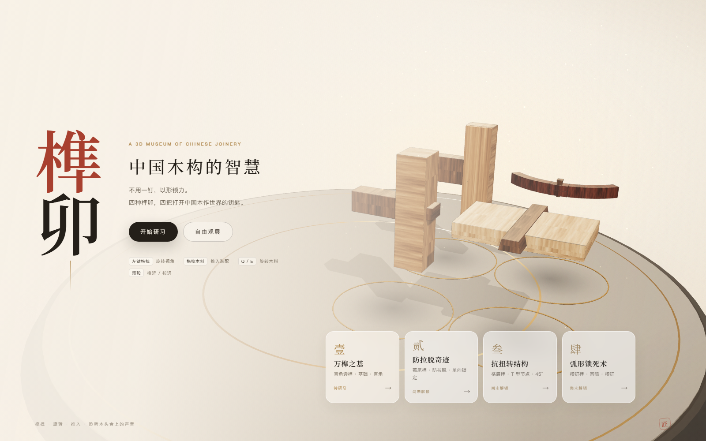
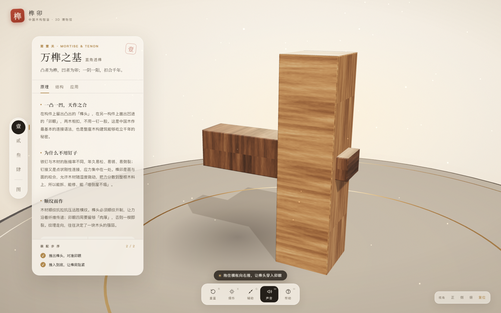
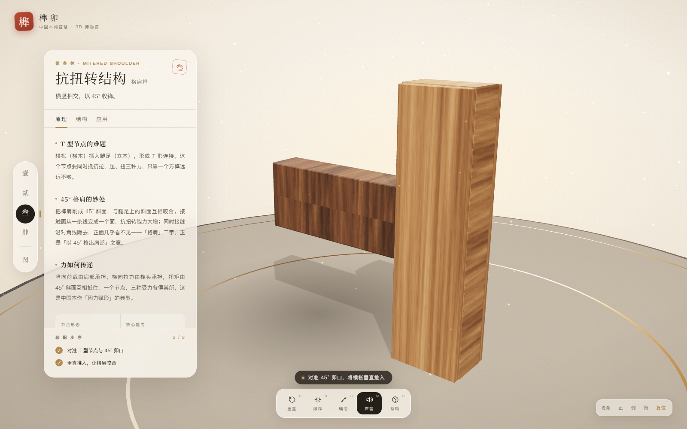
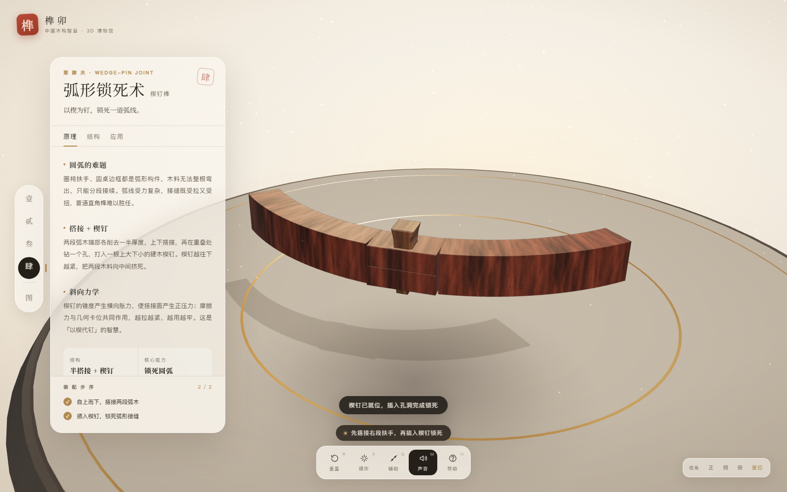

# 榫卯 · 中国木构智慧 3D 博物馆

> 尝试DeepSeek-V4.1-Flash-1017-High 许愿式编程+3D能力的产品，dsh中跑的，整个项目包含下文一轮直出，包括下面的README也是AI自己生成的，项目启动Windows端可尝试直接双击运行start.cmd或按照README的指引来。仅有这段话与AI使用说明.md是自己写的（提示词都是在ds网页版中进行打磨然后人工精修的）


> 不用一钉，以形锁力。四种榫卯，四把打开中国木作世界的钥匙。

一个可以直接在浏览器里动手拆装的 3D 榫卯教学游戏：拖拽木料、旋转对齐、推入吸附，
在木头的碰撞声里理解直角透榫、燕尾榫、格肩榫与楔钉榫的受力逻辑。



| 直角透榫 | 格肩榫 | 楔钉榫 |
| --- | --- | --- |
|  |  |  |

---

## 一、快速开始

本项目是**零构建的纯静态 ESM 工程**，three.js 已本地化到 `vendor/`，**不需要 `npm install`，也不需要任何外网资源**。

### 方式 A：内置 Node 静态服务器（推荐）

```bash
node tools/server.mjs 8000
# 打开 http://localhost:8000
```

Windows 下也可以直接双击 **`start.cmd`**（会自动开浏览器）。

### 方式 B：Python

```bash
python -m http.server 8000
# 打开 http://localhost:8000
```

### 方式 C：任意静态服务器

```bash
npx serve -l 8000 .
```

> ⚠️ 必须通过 `http://` 访问。直接双击 `index.html` 会因浏览器对 ES Module 的
> `file://` 限制而无法加载模块。

运行环境：Chrome / Edge / Firefox / Safari 最新版，需支持 WebGL2（默认开启硬件加速即可）。

---

## 二、怎么玩

| 操作 | 说明 |
| --- | --- |
| 按住木料拖动 | 沿装配轴推入 / 拉出 |
| 拖动空白处 | 旋转视角（轨道相机） |
| 滚轮 / 双指 | 缩放 |
| 右键拖动 | 平移视角 |
| `Q` / `E` | 旋转木料 15°（燕尾榫关卡需要先转正） |
| `R` | 重置本关 |
| `X` | 爆炸视图：拆开看内部榫卯 |
| `G` | 装配辅助线（轴线 / 落位环 / 箭头） |
| `M` | 静音 / 开启声音 |
| `H` | 操作帮助 |
| `1`–`4` | 快速切换已解锁关卡 |
| `Esc` | 关闭弹层 |

**通关目标**：把发光幽灵（Ghost）位置的木料推入、吸附、合榫。每一步都会实时打勾，
全部完成后镜头会自动推近，弹出一张「合榫」卡片与一道随堂问答。

---

## 三、技术选型与架构

### 选型

| 需求 | 方案 | 理由 |
| --- | --- | --- |
| 3D 渲染 | **Three.js r170（本地 vendor）** | 成熟稳定，`ExtrudeGeometry` / 自定义 BufferGeometry 足以精确表达榫卯 |
| 构建 | **无构建，原生 ES Module** | 双击/一条命令即可跑；便于逐文件阅读与二次开发 |
| 材质 | **程序化 PBR 木材** | 无贴图资源依赖，木纹、法线、粗糙度全部由周期噪声生成 |
| 物理 | **不开物理引擎** | 装配是「约束 + 吸附」而非刚体模拟，更可控、更稳、更省性能 |
| 动画 | **自研 60 行补间引擎** | 相机运镜、吸附、爆炸视图共用一个节奏系统 |
| 音效 | **WebAudio 程序化合成** | 木头敲击 / 摩擦 / 上锁 / 五声音阶完成音，零音频文件 |
| UI | **原生 DOM + CSS** | 新中式排版与毛玻璃面板，无框架负担 |

### 模块结构

```
sunmao/
├─ index.html                 应用外壳（品牌、面板、工具栏、落地页、弹层、Loader）
├─ styles.css                 新中式极简视觉系统（响应式 / 动效 / 毛玻璃）
├─ start.cmd                  Windows 一键启动
├─ package.json               type: module + npm start / npm test
├─ vendor/                    本地化 three.js r170 与三个 addon（OrbitControls /
│  ├─ three.module.js         RoundedBoxGeometry / RoomEnvironment）
│  └─ addons/
├─ src/
│  ├─ main.js                 启动入口
│  ├─ three.js                统一 re-export，业务代码只从 'src/three.js' 取 three
│  ├─ core/
│  │  ├─ engine.js            渲染器 / 相机 / 灯光 / 展台 / 尘埃 / 轨道控制 / 取景运镜
│  │  ├─ wood.js              程序化木纹高度场 → 颜色 / 法线 / 粗糙度贴图 + 材质库
│  │  ├─ audio.js             WebAudio 音效引擎
│  │  └─ anim.js              补间与缓动
│  ├─ geometry/
│  │  └─ shapes.js            圆角盒、侧视/俯视参数化挤出、带孔卯眼、圆弧扫掠、合并几何
│  ├─ levels/
│  │  ├─ common.js            构件描述（起点 / 目标 / 轴 / 爆炸方向 / 步序）
│  │  ├─ level1.js            直角透榫
│  │  ├─ level2.js            燕尾榫（滑动燕尾 / 穿带）
│  │  ├─ level3.js            格肩榫（45° 斜肩 + 卯口）
│  │  ├─ level4.js            楔钉榫（半搭接 + 锥形楔钉）
│  │  └─ index.js             关卡注册表
│  ├─ game/
│  │  ├─ interaction.js       拾取 / 轴向拖拽 / 幽灵 / 吸附 / 旋转微调 / 辅助线 / 悬停高亮
│  │  └─ museum.js            总控：模式、关卡装载、步序判定、爆炸视图、进度、图谱、相机
│  ├─ ui/
│  │  └─ ui.js                落地页 / 知识面板 / 步序 / 工具条 / 弹层 / Toast / 悬停木牌
│  └─ data/
│     └─ knowledge.js         全部科普文本、匠诀、数据与随堂问答
├─ tools/
│  ├─ server.mjs              零依赖静态服务器
│  └─ check-geometry.mjs      几何自检（Node 端验证四关模型）
└─ screenshots/               README 配图
```

### 数据流

```
main.js
  └─ Museum
       ├─ Stage          渲染循环 / 相机 / 灯光 / 展台
       ├─ Interaction    指针 → 轴向位移 → 吸附事件
       ├─ UI             状态 → DOM（面板 / 步序 / 弹层）
       ├─ AudioEngine    交互事件 → 合成音效
       └─ LEVEL_DEFS     关卡几何 + knowledge.js 文本
```

每一关的构建函数 `create(materials)` 只返回「构件描述」：
几何体、装配目标位置、初始位置、拖拽轴、爆炸方向、所属步序。
`Museum` 负责把它们变成网格、挂到场景、交给 `Interaction`；
`UI` 只消费状态，不碰 3D。

---

## 四、四关知识点

| 关 | 榫卯 | 核心知识 | 交互 |
| --- | --- | --- | --- |
| 壹 | **直角透榫** | 凸为榫凹为卯；为何不用钉；顺纹受力；透榫 / 半榫 / 榫肩 | 拖拽横枨，榫头穿入卯眼，外露榫头 |
| 贰 | **燕尾榫** | 端宽根窄的单向锁定；1:6–1:8 斜度；明燕尾 / 隐燕尾 / 滑动燕尾 | 先 Q/E 旋转 45° 转正，再沿燕尾槽推入 |
| 叁 | **格肩榫** | T 型节点的拉 / 压 / 扭；45° 格肩增大接触面并隐缝 | 对准卯口垂直推入，肩部咬合 |
| 肆 | **楔钉榫** | 圆弧构件分段；半搭接；锥形楔钉的横向胀力 | 先自上而下搭接弧木，再插楔钉锁死 |

除了动手装配，每关面板都有「原理 / 结构 / 应用」三页科普、四组数据卡、一句匠诀，
通关后还有一道随堂问答；四关之后可在「图谱」里俯瞰四件作品。

---

## 五、实现细节

### 1. 程序化木材（`src/core/wood.js`）

- 用**可平铺的周期值噪声**叠出木纹高度场（顺纹拉伸、横纹高频、棕眼细节）；
- 由同一高度场派生：4 种木色的**颜色贴图**、**法线贴图**、**粗糙度贴图**；
- 材质使用 `MeshPhysicalMaterial` + `clearcoat` + `envMapIntensity`，
  配合 `RoomEnvironment` 的 PMREM 环境光；
- 全部在 768² 画布内生成，无任何图片文件，离线可用。

### 2. 榫卯几何（`src/geometry/shapes.js`）

- **侧视轮廓挤出**：横枨的榫头、45° 斜肩、透榫肩部都由一张 2D 轮廓精确挤出；
- **带孔挤出**：立柱的卯眼 = 一个矩形轮廓 + 一个孔洞路径，挤出后就是贯穿卯眼；
- **圆弧扫掠**：自写 `sweepArc()`，沿水平圆弧生成带法线与 UV 的矩形截面扶手；
- **俯视挤出 + 孔洞**：楔钉榫的半搭接舌板与楔钉孔；
- 所有构件带圆角 / 倒角与 `EdgesGeometry` 轮廓线，观察榫卯更清楚。

### 3. 拖拽与吸附（`src/game/interaction.js`）

- 拾取使用 Raycaster，拖拽前把相机控制禁用（捕获阶段拦截，避免和 OrbitControls 打架）；
- 拖拽被约束在「构件起点 → 目标点」的轴线上：用**包含轴线且正对相机的平面**做射线求交，
  再投影到轴线，得到平滑的一维位移；
- 目标处常驻半透明幽灵（Ghost），接近 / 角度对齐 / 可吸附时透明度与金色边线逐级增亮；
- 松手时同时判定**位置误差**与**角度误差**，满足容差就播放吸附动画 + 木质敲击声；
- 燕尾榫的旋转微调绕构件自身轴心，按 15° 步进，UI 实时显示角度差。

### 4. 相机与构图（`src/core/engine.js`）

- 自动用关卡包围盒 + 垂直 / 水平视场角计算取景距离；
- 为了让左侧知识面板不遮挡展品，取景目标会沿相机右向量做偏置（桌面端）；
- 关卡切换、完成、爆炸、视角预设全部走同一条补间管线。

### 5. 音效（`src/core/audio.js`）

- 木料敲击 = 带通噪声 + 低频正弦衰减；
- 拖动 = 随机频段短噪声；
- 吸附 / 上锁 / 完成 = 噪声 + 音高滑落 + 五声音阶琶音；
- 首次用户手势解锁 AudioContext。

### 6. 进度与状态

- `localStorage` 保存解锁进度、已通关关卡与问答结果；
- 每次进入关卡重新构建几何（保证重置干净），离开时 `dispose` 几何体与临时材质；
- 步序（对准 / 旋转 / 推入）在每帧轻量判定，完成后打勾并解锁下一构件（如楔钉）。

---

## 六、自检

```bash
npm test
# 或 node tools/check-geometry.mjs
```

会在 Node 端构建四关模型，检查：

- 每个几何体顶点数据有效、含 UV、尺度合理；
- 构件 id 唯一、可拖拽构件行程 > 0.5；
- 步序引用的构件存在；
- 装配态整体包围盒在展台范围内。

---

## 七、兼容与性能

- 目标 60fps：单场景约 50–60 draw call、1 万级三角面、一张 2048 阴影贴图；
- 像素比上限 2，移动端自动隐藏辅助面板，可随时点「知识」展开；
- 所有几何 / 贴图 / 音效运行时生成，首次加载只读本地静态文件；
- 无 WebGL 时显示友好兜底页。

---

## 八、二次开发

**新增一关**只需两步：

1. 在 `src/levels/` 新建 `level5.js`，导出 `meta`（相机方向、步序）与 `create(materials)`，
   用 `makePiece()` 描述构件；
2. 在 `src/levels/index.js` 注册，并在 `src/data/knowledge.js` 增加对应科普内容。

**换木种**：修改 `src/core/wood.js` 里的 `PALETTES`（暗 / 中 / 亮三档色阶）即可。

**加音效**：在 `AudioEngine` 里组合噪声 / 振荡器，保持 `this.ready` 判断。

---

## 九、素材与许可

- 代码：可自由学习、修改与二次分发。
- 三维模型、木纹贴图、环境、音效：**全部程序化生成**，不含任何第三方素材。
- [three.js](https://threejs.org/) r170，MIT License，已本地化于 `vendor/`。
